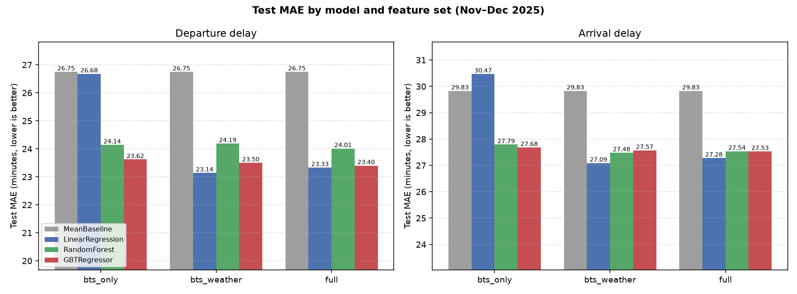
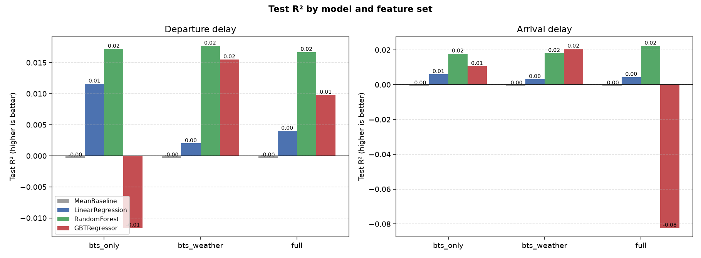
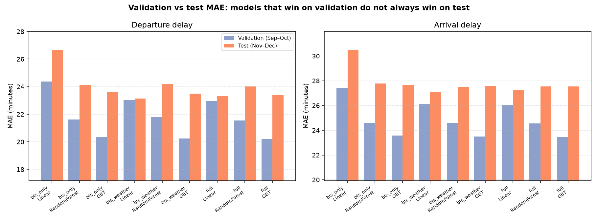
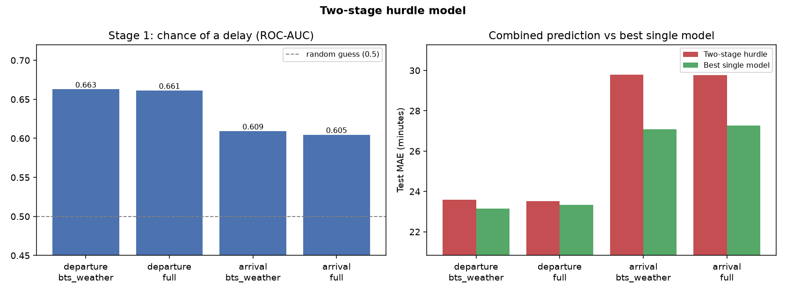
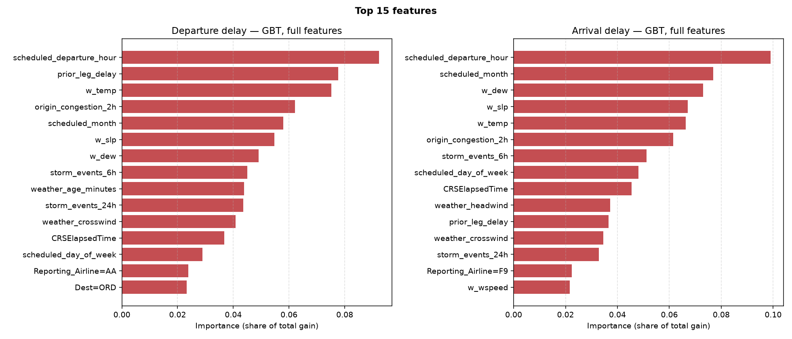
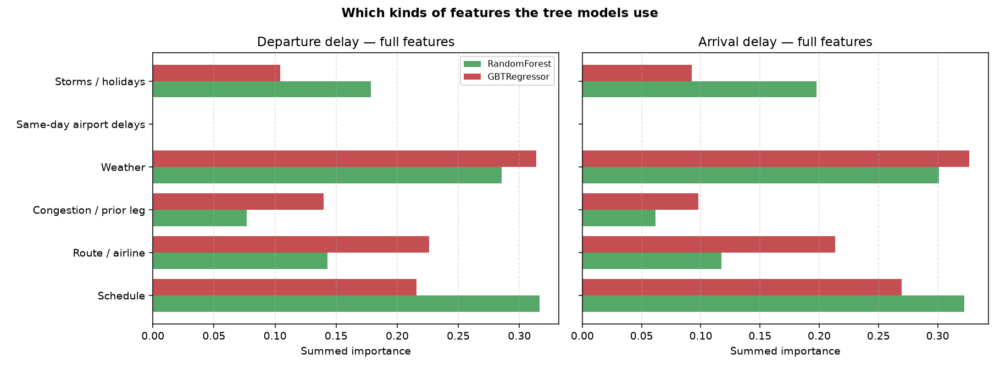
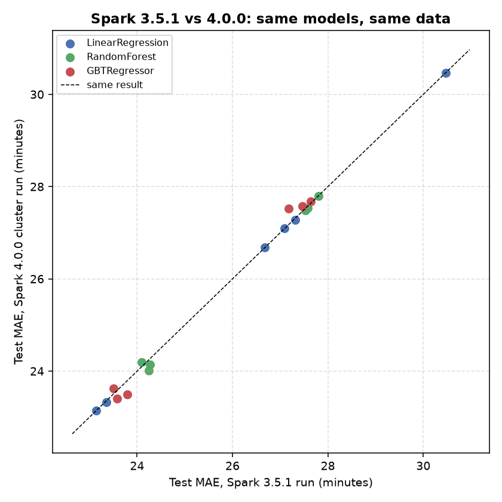
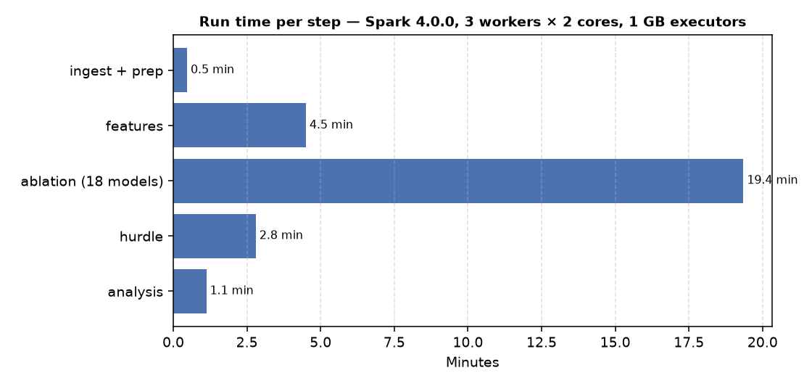

# Flight delay prediction — Spark 4.0.0 cluster run, 21 Nov 2026

The full pipeline (`ingest prep features ablation hurdle analysis`) ran to completion on a 3-worker Spark 4.0.0 cluster in 28 minutes, and all 21 tests pass. The models beat a mean-delay baseline by 2.7–3.6 minutes of MAE, but explain under 3% of the variance in delays (best test R² = 0.022). The 10 "same-day airport delay" features are all zero because of a bug, so the `full` feature set has not really been tested yet (see [Open issues](#open-issues)).

## Run setup

| Item | Value |
|---|---|
| Branch / commit | `feature_Keerthana` @ `a65316c` + uncommitted feature-name fix in `src/analysis/feature_importance.py` |
| Spark | 4.0.0 (Scala 2.13.16, Java 17, PySpark 4.0.0, ANSI mode on) |
| Image | `spark-local:4.0.0-zscaler`, built from `spark_docker/` (Spark assembled from Maven Central + GitHub source because Zscaler blocks the 543 MB tarball) |
| Cluster | 1 master + 3 workers × 2 cores; executors 1 GB × 2 cores; driver 2 GB |
| Command | `SPARK_EXECUTOR_MEMORY=1g SPARK_DRIVER_MEMORY=2g ./spark_docker/submit.sh --steps ingest prep features ablation hurdle analysis` |
| Data | BTS on-time 2025, flights where both ends are in ATL, CLT, DEN, DFW, LAS, LAX, MCO, ORD, PHX, SEA; NOAA hourly weather; NOAA storm events; US holidays |
| Rows | 465,685 flights after cleaning; weather matched for 100.00% |
| Split | Train Jan–Aug, validation Sep–Oct, test Nov–Dec (by date, no shuffling) |
| Tests | 21 passed (`pytest tests`, in the Spark 4.0.0 image) |

Feature sets:

- **bts_only** (9 inputs): origin, destination, airline, month, day of week, scheduled hour, scheduled flight time, departures from the same airport in the previous 2 h, delay of the same aircraft's previous leg.
- **bts_weather**: bts_only + 10 weather inputs (temperature, dew point, wind speed, pressure, crosswind, headwind, icing risk, IFR conditions, weather available, weather age).
- **full**: bts_weather + 10 same-day airport delay counts + storms in the last 6 h / 24 h + holiday flags.

All features use only information available 2 hours before scheduled departure.

## Results

### Single-stage models (test = Nov–Dec 2025)



| Task | Feature set | Mean baseline | Linear Reg. | Random Forest | GBT |
|---|---|---|---|---|---|
| Departure | bts_only | 26.75 | 26.68 | 24.14 | **23.62** |
| Departure | bts_weather | 26.75 | **23.14** | 24.19 | 23.50 |
| Departure | full | 26.75 | **23.33** | 24.01 | 23.40 |
| Arrival | bts_only | 29.83 | 30.47 | 27.79 | **27.68** |
| Arrival | bts_weather | 29.83 | **27.09** | 27.48 | 27.57 |
| Arrival | full | 29.83 | **27.28** | 27.54 | 27.53 |

Test MAE in minutes; bold = best per row. Full metrics (RMSE, R², validation scores) are in [`data/controlled_ablation_summary.csv`](data/controlled_ablation_summary.csv).

- **Best departure model:** Linear Regression on bts_weather, 23.14 min, 3.61 min (13.5%) better than the baseline.
- **Best arrival model:** Linear Regression on bts_weather, 27.09 min, 2.74 min (9.2%) better than the baseline.
- **Weather helps.** Adding weather cuts Linear Regression's MAE by 3.5 min (departure) and 3.4 min (arrival). For the tree models the gain is under 0.3 min.
- **`full` adds nothing over `bts_weather`**, which is expected while the same-day delay features are all zero.



- **R² is very low everywhere**: at most 0.018 for departure and 0.022 for arrival. The models get the typical delay closer than the average does, but barely explain which individual flights will be very late. RMSE stays around 56–59 min because of the long tail of large delays.
- **Arrival / full / GBT is unstable on test**: R² −0.082 and RMSE 61.5 min, worse than the baseline, while its validation R² (0.090) is the best of all arrival models.



- **Validation and test disagree.** On validation (Sep–Oct) GBT is always best (about 20.2 min departure, 23.4 min arrival). On test (Nov–Dec) Linear Regression wins with bts_weather and full.
- **The tree models lose the most on test.** GBT is 3.2–4.1 min worse on test than on validation, and Random Forest 2.4–3.2 min worse. Linear Regression with weather loses only 0.1–1.2 min. The tree models fit patterns from the earlier months that don't hold in the holiday months, which is why the simpler model wins on test.

### Two-stage hurdle model

Stage 1 (Logistic Regression) predicts whether a flight is delayed; stage 2 (GBT on log delay) predicts how long, trained on delayed flights only; prediction = probability × length.



| Task | Feature set | Stage 1 ROC-AUC | Hurdle MAE | Best single model MAE | Hurdle R² |
|---|---|---|---|---|---|
| Departure | bts_weather | 0.663 | 23.60 | 23.14 | 0.014 |
| Departure | full | 0.661 | 23.51 | 23.33 | 0.012 |
| Arrival | bts_weather | 0.609 | 29.79 | 27.09 | 0.017 |
| Arrival | full | 0.605 | 29.76 | 27.28 | 0.016 |

- The delay classifier is only moderately better than chance (AUC 0.61–0.66).
- The hurdle model does not beat the best single model; for arrival it is 2.5–2.7 min worse.

### What the models use

Feature importances are from the saved Random Forest and GBT models. Names are now correct: each one-hot category gets its own label (for example `Dest=ORD`), see the fix described under [Changes made](#changes-made-during-this-run).





- **Top signals:** scheduled departure hour (0.092 departure, 0.099 arrival), the aircraft's previous-leg delay (0.078, departure), temperature / dew point / pressure, airport congestion in the last 2 hours, and month.
- **Weather is the largest feature family** for GBT (about 0.31–0.33 of total importance), followed by schedule and route/airline.
- **Same-day airport delays have exactly 0 importance** in all models: the features are constant (bug below).
- Individual airports and airlines matter little on their own; the top one-hot categories are `Reporting_Airline=AA`, `Dest=ORD` and `Reporting_Airline=F9` at about 0.02 each.

### Spark 3.5.1 vs Spark 4.0.0

The same pipeline was run earlier today on Spark 3.5.1 (single container, `local[*]`). Results match closely:



- Linear Regression results are the same to within 0.03 min.
- Random Forest and GBT differ by at most 0.35 min (arrival / full / GBT: 27.18 → 27.53), because random tree building is not bit-for-bit reproducible across Spark versions and partition layouts.
- Spark 4's ANSI mode raised no errors.

### Run time



| Step | Duration |
|---|---|
| Ingest + preprocessing (raw files already cached) | 0.5 min |
| Feature engineering | 4.5 min |
| Ablation (18 models with tuning) | 19.4 min |
| Hurdle model | 2.8 min |
| Analysis (importances + residual plots) | 1.1 min |
| **Total** | **28.2 min** |

The only error-level line in the log, `Failed to remove broadcast 12199 … does not exist`, is a Spark cleanup warning and did not affect any step.

## Open issues

1. **Bug: the 10 same-day airport delay features are always 0** (`airport_nas_delays_today`, `airport_avg_delay_today`, … in `src/features/engineering.py`, `_add_delay_cause_aggregates`, added in `ad85b93`). The "known at prediction time" flag compares each flight's departure time with its *own* T−2h (`dep_sec <= t_minus_2_sec`), which is never true, so every value is zeroed. Verified on the saved feature set: 0 non-zero values in 465,685 rows. A likely fix is to count only earlier flights scheduled at least 2 h before the current one, e.g. `rangeBetween(Window.unboundedPreceding, -7200)` on the departure-time window. One design point to decide first: a flight that departed at T−2h may not have landed yet, so its delay-cause minutes (`NASDelay`, `WeatherDelay`, …) are only reported after arrival and could leak future information. After the fix, `features`, `ablation`, `hurdle` and `analysis` need rerunning (about 28 min).
2. **Weak models.** Best R² is 0.022. Worth trying once the bug above is fixed: a log or capped target for the single-stage models, and real-time airport state (the fixed delay aggregates, FAA ground-delay programs).
3. **Validation/test mismatch.** Tuning on Sep–Oct doesn't carry over to Nov–Dec. Rolling-origin validation, or including holiday periods in training, would give more reliable model selection.
4. **Not run:** `produce` / `stream` (Kafka), `benchmarks`, `cluster_bench`, and the Streamlit app.
5. **Local setup only.** The Spark 4.0.0 used here is assembled from Maven Central jars (no Hive / YARN / Kubernetes / cloud-storage connectors) and can't be checked against Apache's tarball checksum. The team's root `Dockerfile.spark` is unchanged.

## Changes made during this run

- `src/analysis/feature_importance.py` (uncommitted): feature names are now expanded per one-hot category using the saved `StringIndexer` labels and `OneHotEncoder` slot counts. Before, names were taken from the ~30 assembler input columns and lined up against 60+ vector slots, so labels were shifted and the rest showed as `feature_43` etc. Importances were regenerated from the saved models; no retraining was needed.
- `spark_docker/` (gitignored): switched to the assembled Spark 4.0.0, image tag `spark-local:4.0.0-zscaler`, Zscaler certificate added to Java's trust store. 3.5.1 versions of the files are kept as `*.3.5.1.bak`.

## Files in this folder

| Path | Contents |
|---|---|
| `REPORT.md` | This report |
| `charts/` | 8 summary charts above, built by `make_charts.py` |
| `plots/` | 52 plots from the pipeline's analysis step: feature importance per model, predicted vs actual, residual distributions, Q–Q plots, hurdle calibration |
| `data/controlled_ablation_summary.csv` | All 24 single-stage results (test + validation MAE, RMSE, R²) |
| `data/two_stage_hurdle_results.csv` | Hurdle model results |
| `data/feature_importances.csv` | 628 rows: importance per feature, model, task and feature set |
| `data/controlled_ablation_summary_spark351.csv` | Earlier Spark 3.5.1 results, for comparison |
| `data/pipeline_run.log` | Full log of the cluster run |
| `make_charts.py` | Rebuilds `charts/` from `data/` |

To rebuild the charts from the repo root:

```bash
docker run --rm -v "$PWD":/app -w /app spark-local:4.0.0-zscaler \
  python3 reports/spark4_cluster_run_2026-11-21/make_charts.py
```
